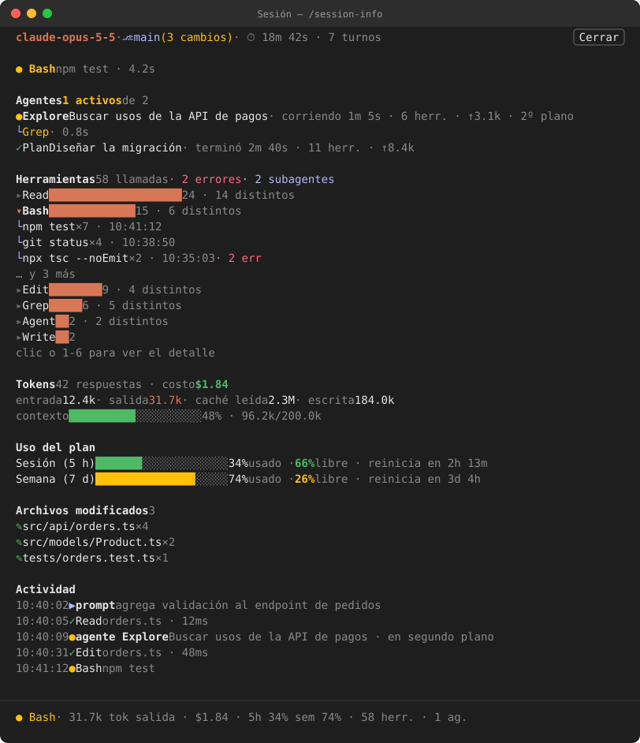

# Personalizaciones de Claude Code

Skills y mods propios para [Claude Code](https://claude.com/claude-code), publicados como marketplace de plugins.

## Contenido

### Skills (`skills/`)

| Skill | Para qué sirve |
|---|---|
| [`mobile-legal-audit`](skills/mobile-legal-audit/SKILL.md) | Auditoría de cumplimiento legal y de políticas de tienda (Google Play, App Store) de apps móviles, contrastando el código real contra GDPR, CCPA, LGPD, Ley 172-13 de RD, consentimiento de anuncios, suscripciones y propiedad intelectual. Incluye scripts de inventario de SDKs y de medios externos. |
| [`perf-audit`](skills/perf-audit/SKILL.md) | Auditoría de rendimiento: consultas al backend (Express/MongoDB/Mongoose: N+1, índices, `.lean()`, payloads) y tamaño del bundle (Flutter, assets, dependencias sin uso, R8). Mide primero y entrega un informe con cifras y orden sugerido. Incluye scripts de inventario de assets, optimización de imágenes, dependencias sin uso y desglose de `.aab`/`.apk`. |
| [`web-analytics-consent`](skills/web-analytics-consent/SKILL.md) | Instala Google Analytics 4 con banner de cookies (Consent Mode v2) en un sitio estático y actualiza la política de privacidad. |
| [`web-design-guidelines`](skills/web-design-guidelines/SKILL.md) | Revisión de UI contra las Web Interface Guidelines de Vercel (copia local, licencia MIT de Vercel Labs). |

### Mods (`mods/`)

| Mod | Para qué sirve |
|---|---|
| [`session-info`](mods/session-info) | Comando `/session-info`: panel en vivo con modelo, rama de git, herramientas usadas, agentes en curso (tipo, tarea, estado, herramienta actual, tokens), tokens, costo, límites del plan, archivos modificados y actividad de la sesión. |

## Instalación

El repositorio es un marketplace de plugins de Claude Code llamado **`devux`**. Cada skill y el mod se instalan como plugins independientes.

```bash
claude plugin marketplace add miguelcanot/ai

claude plugin install session-info@devux
claude plugin install mobile-legal-audit@devux
claude plugin install perf-audit@devux
claude plugin install web-analytics-consent@devux
claude plugin install web-design-guidelines@devux
```

También puedes hacerlo desde Claude Code con `/plugin marketplace add miguelcanot/ai` y `/plugin install <plugin>@devux`, o abrir `/plugin` y elegirlos en la lista. Reinicia Claude Code después de instalar el mod.

Para recibir cambios nuevos: `claude plugin marketplace update devux` y luego `claude plugin update <plugin>@devux`.

Las skills localizan sus scripts con `${CLAUDE_SKILL_DIR}`, así que funcionan igual instaladas como plugin, copiadas en `~/.claude/skills/` o dentro de `<proyecto>/.claude/skills/`. Para instalar a mano sin el marketplace, copia la carpeta de la skill a cualquiera de esas rutas.

### Requisitos de cada skill

- **`mobile-legal-audit`**: Python 3. Los scripts reciben la raíz del proyecto auditado:
  - `sdk_inventory.py <raíz>`: SDKs, permisos y piezas de cumplimiento.
  - `external_media.py <raíz> [--all]`: medios cargados desde dominios de terceros (`--all` incluye también APIs y documentación).
- **`perf-audit`**: Python 3 (`optimize_images.py` además necesita Pillow: `pip install Pillow`) y bash para `unused_deps.sh`. Los comandos de ejemplo del backend asumen el código en `server/src`; ajústalo a la carpeta real del proyecto. Scripts:

  | Script | Uso |
  |---|---|
  | `asset_inventory.py <dir> [--top N]` | Peso, dimensiones reales y total de las imágenes (lista las `N` más pesadas, 30 por defecto). |
  | `optimize_images.py <dir> [--max-width N] [--max-height N] [--quality Q] [--quantize] [--dry-run] [--backup-dir D]` | Redimensiona y recomprime, y reporta la pérdida (PSNR). Guarda los originales salvo con `--no-backup`; `--dry-run` solo reporta. |
  | `unused_deps.sh [ruta-al-proyecto]` | Dependencias de `pubspec.yaml` que nada en `lib/` parece usar (por defecto, el directorio actual). |
  | `aab_breakdown.py <aab-o-apk> [--assets] [--abi ABI]` | Desglose del artefacto y tamaño que descarga de verdad el usuario (`--abi` por defecto `arm64-v8a`). |

- **`web-analytics-consent`**: copia `consent.template.js` al sitio; el Measurement ID, la clave de `localStorage` y los estilos del banner se editan dentro de ese archivo.
- **`web-design-guidelines`**: lleva una copia local de las reglas de [vercel-labs/web-interface-guidelines](https://github.com/vercel-labs/web-interface-guidelines) (MIT), así que no necesita red.

## Uso de `session-info`

| Comando | Efecto |
|---|---|
| `/session-info` | Abre el panel **Sesión** y escribe un resumen en el chat. |
| `/session-info cerrar` | Cierra el panel (también acepta `close`, o el botón **Cerrar** del panel). |

En el panel, pulsar una herramienta despliega para qué se usó (archivos, comandos, skills); pulsarla otra vez la pliega. Si la terminal es demasiado estrecha el panel no se coloca y el resumen lo avisa: ensancha la ventana y vuelve a ejecutar el comando.

### Ejemplo

Así se ve el panel a mitad de una tarea, con la herramienta `Bash` desplegada (datos inventados):



Mientras hay trabajo en curso, la barra de estado de Claude Code muestra un resumen de una línea:

```text
● Bash · 31.7k tok salida · $1.84 · 5h 34% sem 74% · 58 herr. · 1 ag.
```

Iconos: `●` en curso, `✓` terminado, `✗` error, `⊘` denegado o detenido, `◐` esperando, `▶` prompt. Las barras de contexto y de plan cambian de color (verde → amarillo → rojo) al acercarse al límite.

## Desarrollo

Para probar cambios sin publicarlos, agrega tu clon local como marketplace en lugar del repo de GitHub:

```bash
claude plugin marketplace add /ruta/al/clon
claude plugin install session-info@devux
```

Claude Code usa una copia en caché por versión (`~/.claude/plugins/cache/devux/<plugin>/<versión>`), así que editar los archivos no basta. Las skills no declaran versión: su versión es el commit, así que los cambios llegan a quien las instaló desde GitHub cuando se hace push. Tras cambiar el mod:

1. Sube `version` en `mods/session-info/.claude-plugin/plugin.json`.
2. Ejecuta `claude plugin marketplace update devux` y `claude plugin update session-info@devux`.
3. Reinicia Claude Code. `claude plugin list` muestra la versión cargada.

Validación:

```bash
claude plugin validate .                   # valida el marketplace
claude plugin validate mods/session-info   # valida el manifiesto y el módulo de hooks
claude plugin test mods/session-info       # ejecuta hooks/*.test.ts
npx tsc -p mods/session-info               # verificación de tipos
```

Claude Code genera las declaraciones de tipos en `mods/session-info/.claude-plugin/types/` al cargar el mod (no se versionan); `tsc` las necesita.

## Licencia

[MIT](LICENSE). `skills/web-design-guidelines/references/guidelines.md` es de Vercel Labs, también MIT (ver [su licencia](skills/web-design-guidelines/LICENSE)).
