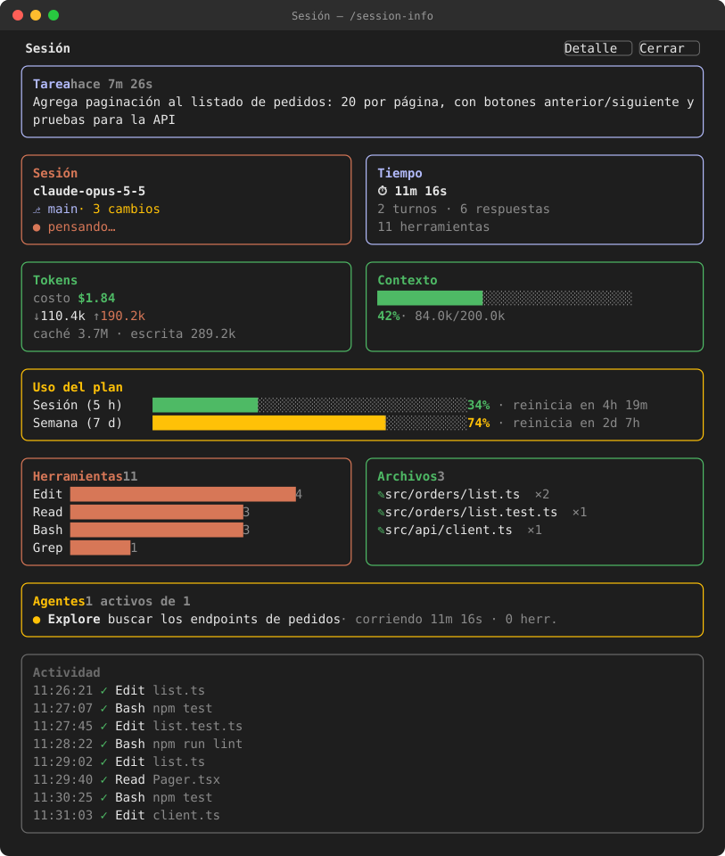
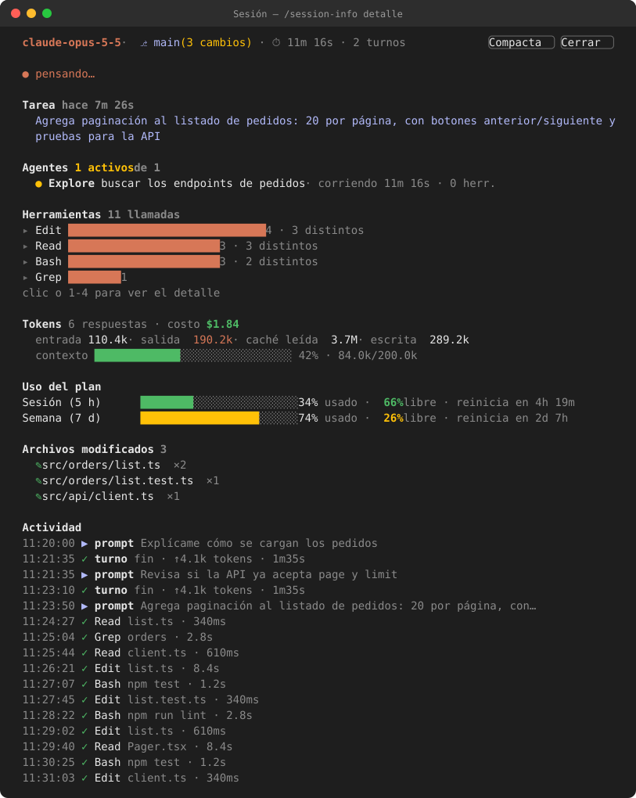

# Personalizaciones de Claude Code

Skills y mods propios para [Claude Code](https://claude.com/claude-code), publicados como marketplace de plugins.

## Contenido

### Skills (`skills/`)

| Skill | Para qué sirve |
|---|---|
| [`mobile-legal-audit`](skills/mobile-legal-audit/SKILL.md) | Auditoría de cumplimiento legal y de políticas de tienda (Google Play, App Store) de apps móviles, contrastando el código real contra GDPR, CCPA, LGPD, Ley 172-13 de RD, consentimiento de anuncios, suscripciones y propiedad intelectual. Incluye scripts de inventario de SDKs y de medios externos. |
| [`legal-pages`](skills/legal-pages/SKILL.md) | Redacta la política de privacidad, los términos de uso o licencia y la política de cookies de un producto (escritorio, web/SaaS, extensión, CLI, landing) a partir de lo que el código envía y guarda, y las enlaza desde el sitio y la app. Cubre apps local-first, servidores de licencias, integraciones con cuentas del usuario, IA con clave propia y sitios sin cookies. Incluye un script de inventario y una plantilla HTML. |
| [`perf-audit`](skills/perf-audit/SKILL.md) | Auditoría de rendimiento: consultas al backend (Express/MongoDB/Mongoose: N+1, índices, `.lean()`, payloads) y tamaño del bundle (Flutter, assets, dependencias sin uso, R8). Mide primero y entrega un informe con cifras y orden sugerido. Incluye scripts de inventario de assets, optimización de imágenes, dependencias sin uso y desglose de `.aab`/`.apk`. |
| [`web-analytics-consent`](skills/web-analytics-consent/SKILL.md) | Instala Google Analytics 4 con banner de cookies (Consent Mode v2) en un sitio estático y actualiza la política de privacidad. |
| [`web-design-guidelines`](skills/web-design-guidelines/SKILL.md) | Revisión de UI contra las Web Interface Guidelines de Vercel (copia local, licencia MIT de Vercel Labs). |

### Mods (`mods/`)

| Mod | Para qué sirve |
|---|---|
| [`session-info`](mods/session-info) | Comando `/session-info`: panel en vivo con modelo, rama de git, herramientas usadas, agentes en curso (tipo, tarea, estado, herramienta actual, tokens), tokens, costo, límites del plan, archivos modificados y actividad de la sesión. |
| [`attachments`](mods/attachments) | Comando `/adjuntos`: panel de archivos adjuntos. Arrastra archivos o carpetas de cualquier lugar a la terminal y Claude trabaja con ellos en cada petición, sin copiarlos al proyecto ni pedir permiso para leerlos. |

## Instalación

El repositorio es un marketplace de plugins de Claude Code llamado **`devux`**. Cada skill y el mod se instalan como plugins independientes.

```bash
claude plugin marketplace add miguelcanot/ai

claude plugin install session-info@devux
claude plugin install attachments@devux
claude plugin install mobile-legal-audit@devux
claude plugin install legal-pages@devux
claude plugin install perf-audit@devux
claude plugin install web-analytics-consent@devux
claude plugin install web-design-guidelines@devux
```

También puedes hacerlo desde Claude Code con `/plugin marketplace add miguelcanot/ai` y `/plugin install <plugin>@devux`, o abrir `/plugin` y elegirlos en la lista. Reinicia Claude Code después de instalar el mod.

Para recibir cambios nuevos: `claude plugin marketplace update devux` y luego `claude plugin update <plugin>@devux`.

Las skills localizan sus scripts con `${CLAUDE_SKILL_DIR}`, así que funcionan igual instaladas como plugin, copiadas en `~/.claude/skills/` o dentro de `<proyecto>/.claude/skills/`. Para instalar a mano sin el marketplace, copia la carpeta de la skill a cualquiera de esas rutas.

### Requisitos de cada skill

- **`mobile-legal-audit`**: Python 3. Los scripts reciben la raíz del proyecto auditado:
  - `sdk_inventory.py <raíz>`: SDKs, permisos y piezas de cumplimiento.
  - `external_media.py <raíz> [--all]`: medios cargados desde dominios de terceros (`--all` incluye también APIs y documentación).
- **`legal-pages`**: Python 3. `inventory.py <raíz> [--exclude RUTA ...] [--max-hits N]` lista hosts externos, recursos de terceros de las páginas web, almacenamiento local, cookies, IPs, telemetría y pagos, con `archivo:línea` (`--exclude` para maquetas y textos legales ya escritos). Si el sitio no tiene layout propio, las páginas parten de `assets/legal-page.template.html`.- **`perf-audit`**: Python 3 (`optimize_images.py` además necesita Pillow: `pip install Pillow`) y bash para `unused_deps.sh`. Los comandos de ejemplo del backend asumen el código en `server/src`; ajústalo a la carpeta real del proyecto. Scripts:

  | Script | Uso |
  |---|---|
  | `asset_inventory.py <dir> [--top N]` | Peso, dimensiones reales y total de las imágenes (lista las `N` más pesadas, 30 por defecto). |
  | `optimize_images.py <dir> [--max-width N] [--max-height N] [--quality Q] [--quantize] [--dry-run] [--backup-dir D]` | Redimensiona y recomprime, y reporta la pérdida (PSNR). Guarda los originales salvo con `--no-backup`; `--dry-run` solo reporta. |
  | `unused_deps.sh [ruta-al-proyecto]` | Dependencias de `pubspec.yaml` que nada en `lib/` parece usar (por defecto, el directorio actual). |
  | `aab_breakdown.py <aab-o-apk> [--assets] [--abi ABI]` | Desglose del artefacto y tamaño que descarga de verdad el usuario (`--abi` por defecto `arm64-v8a`). |

- **`web-analytics-consent`**: copia `consent.template.js` al sitio; el Measurement ID, la clave de `localStorage` y los estilos del banner se editan dentro de ese archivo.
- **`web-design-guidelines`**: lleva una copia local de las reglas de [vercel-labs/web-interface-guidelines](https://github.com/vercel-labs/web-interface-guidelines) (MIT), así que no necesita red.

## Uso de `session-info`

| Comando | Efecto |
|---|---|
| `/session-info` | Abre el panel **Sesión** en vista compacta (tarjetas) y escribe un resumen en el chat. |
| `/session-info detalle` | Abre el panel en vista detallada (también acepta `detail`). |
| `/session-info cerrar` | Cierra el panel (también acepta `close`, o el botón **Cerrar** del panel). |

La vista compacta agrupa los datos en tarjetas con borde: la tarea (el último mensaje que escribiste en el chat), sesión, tiempo, tokens, contexto, uso del plan, herramientas, archivos, agentes y actividad. Desde 70 columnas las tarjetas van en pares; en paneles más estrechos se apilan. Los botones **Detalle** y **Compacta** cambian de vista sin cerrar el panel.

La vista detallada también muestra la tarea en su sección **Tarea**. En ella, pulsar una herramienta despliega para qué se usó (archivos, comandos, skills); pulsarla otra vez la pliega. Si la terminal es demasiado estrecha el panel no se coloca y el resumen lo avisa: ensancha la ventana y vuelve a ejecutar el comando.

### Ejemplo

Así se ven las dos vistas a mitad de una tarea (datos inventados).

Vista compacta (`/session-info`):



Vista detallada (`/session-info detalle`):



Mientras hay trabajo en curso, la barra de estado de Claude Code muestra un resumen de una línea:

```text
● Bash · 31.7k tok salida · $1.84 · 5h 34% sem 74% · 58 herr. · 1 ag.
```

Iconos: `●` en curso, `✓` terminado, `✗` error, `⊘` denegado o detenido, `◐` esperando, `▶` prompt. Las barras de contexto y de plan cambian de color (verde → amarillo → rojo) al acercarse al límite.

## Uso de `attachments`

Arrastra archivos o carpetas desde el explorador a la terminal de Claude Code (en vez de pegarse como texto, se añaden al panel **Adjuntos**, que se abre solo), o cópialos en el explorador y pulsa **Pegar** en el panel o escribe `/adjuntos pegar`. Ctrl+V no sirve para esto: la terminal se queda la tecla y, si lo copiado es un archivo, no envía nada. En Windows, una imagen copiada (una captura, una imagen del navegador) se guarda como PNG en la carpeta temporal y se adjunta. Después pide lo que quieras ("resume los adjuntos", "compara el PDF con la hoja de cálculo"): Claude ve la lista en cada petición y los lee desde su ruta, sin copiarlos al proyecto y sin pedirte permiso para leerlos.

| Comando | Efecto |
|---|---|
| `/adjuntos` | Abre el panel. |
| `/adjuntos "C:/Mis docs/informe.pdf" …` | Añade rutas sin arrastrar. |
| `/adjuntos pegar` | Añade los archivos copiados en el portapapeles (también el botón **Pegar**). |
| `/adjuntos vaciar` | Quita todos los adjuntos (también el botón **Vaciar**). |
| `/adjuntos cerrar` | Cierra el panel; los adjuntos se mantienen. |

En la terminal de VS Code puedes tener un atajo para pegar adjuntos añadiendo esto a tu `keybindings.json` (úsalo con el prompt vacío, porque escribe el comando detrás de lo que haya):

```json
{
  "key": "ctrl+alt+v",
  "command": "workbench.action.terminal.sendSequence",
  "args": { "text": "/adjuntos pegar\r" },
  "when": "terminalFocus"
}
```

Cada fila del panel tiene un botón **Quitar**. Los adjuntos duran toda la sesión hasta que los quites.

| Tipo | Qué hace Claude |
|---|---|
| Texto, código, CSV, JSON, PDF, imágenes | Los lee con Read. |
| Carpetas | Busca dentro con Glob/Grep y lee lo que necesite. |
| Video, audio, Office, comprimidos, binarios | Recibe ruta, tipo y tamaño, con una pista de cómo procesarlos (p. ej. ffmpeg para video). |

El permiso automático solo cubre leer (Read, Glob, Grep) esas rutas exactas o lo que haya dentro de una carpeta adjunta. El mod solo actúa si todo lo pegado son rutas absolutas que existen; cualquier otro texto se pega normal. Entiende las rutas entre comillas de Windows Terminal, los espacios escapados de macOS y las URL `file://`.

## Desarrollo

Para probar cambios sin publicarlos, agrega tu clon local como marketplace en lugar del repo de GitHub:

```bash
claude plugin marketplace add /ruta/al/clon
claude plugin install session-info@devux
```

Claude Code usa una copia en caché por versión (`~/.claude/plugins/cache/devux/<plugin>/<versión>`), así que editar los archivos no basta. Las skills no declaran versión: su versión es el commit, así que los cambios llegan a quien las instaló desde GitHub cuando se hace push. Tras cambiar el mod:

1. Sube `version` en `mods/session-info/.claude-plugin/plugin.json`.
2. Ejecuta `claude plugin marketplace update devux` y `claude plugin update session-info@devux`.
3. Reinicia Claude Code. `claude plugin list` muestra la versión cargada.

Validación:

```bash
claude plugin validate .                   # valida el marketplace
claude plugin validate mods/session-info   # valida el manifiesto y el módulo de hooks
claude plugin test mods/session-info       # ejecuta hooks/*.test.ts
npx tsc -p mods/session-info               # verificación de tipos
```

Claude Code genera las declaraciones de tipos en `mods/session-info/.claude-plugin/types/` al cargar el mod (no se versionan); `tsc` las necesita.

## Licencia

[MIT](LICENSE). `skills/web-design-guidelines/references/guidelines.md` es de Vercel Labs, también MIT (ver [su licencia](skills/web-design-guidelines/LICENSE)).
